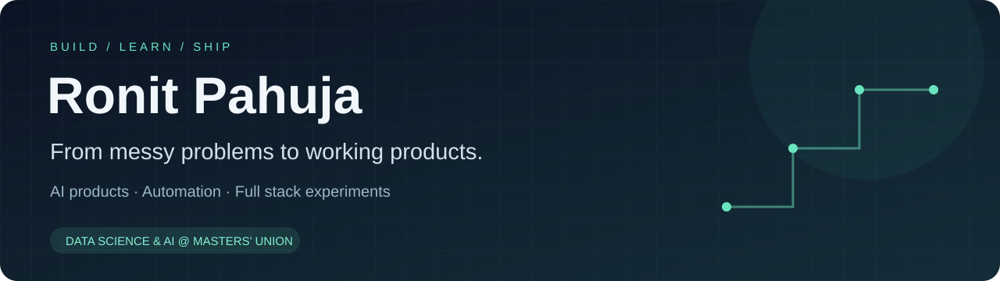

  

  
  

  

## Hey, I'm Ronit 👋

I'm a **Data Science & AI student at Masters’ Union**, working at **ParalaxAI**. I turn practical problems into AI products and business automations, from regulatory tracking to customer workflows.

I build with **AI coding tools**, focusing on product workflows, integrations, and evaluating the result.

## At ParalaxAI — a connected workspace for a client business

**The need:** manage website content, clients, sales opportunities, and inventory-based customer conversations from one place.

**What I built:** an internal dashboard that lets the team update their existing website, track clients and their pipeline, and find the closest in-stock match for customer requests. WhatsApp automation and integrated AI support product recommendations and messaging on the company's behalf.

**What it enables:** website updates, client tracking, inventory matching, and customer communication within a connected workflow.

### Multi-agent outreach at ParalaxAI

I built a system of **12 specialised AI agents** to automate ParalaxAI’s outreach workflow end to end. Each agent uses its own knowledge base and handles a specific part of the workflow, from mapping target markets to classifying replies and routing sensitive conversations to a human.

- **[MarketScout](https://github.com/ronitpahuja08/market-scout-agent)** maps target markets by geography, deduplicates companies, and estimates research coverage before handing results to the next stage.
- **[ReplyGuard](https://github.com/ronitpahuja08/replyguard)** classifies multilingual replies, enforces opt-out rules, and hands sensitive or uncertain conversations to a human.

## Selected projects

| Project | What it does | Project stack |
| :--- | :--- | :--- |
| **[Brain](https://github.com/ronitpahuja08/Brain)** | Extends CompanyBrain, a self-hosted company knowledge platform, with safer deployment defaults, configuration checks, and retrieval quality benchmarks. | TypeScript · PostgreSQL · pgvector |
| **[SafeSignal](https://github.com/ronitpahuja08/ai-women-safety-system)** | Co-built a personal safety prototype with manual SOS, opt-in location sharing, check-in reminders, and optional trusted-contact SMS. | Python · JavaScript · Twilio |
| **[ALGO](https://github.com/ronitpahuja08/ALGO)** | Interactive collision detection lab that visualizes rectangle overlap with mouse, touch, or keyboard controls and includes tests for edge cases. | JavaScript · p5.js · p5.play |
| **[Repo Health MCP](https://github.com/ronitpahuja08/repo-health-mcp)** | A read-only MCP server that explains GitHub repository health using maintenance and contributor activity, and surfaces good first issues. | TypeScript · Node.js · MCP · GitHub REST API |
| **[Grounded RAG](https://github.com/ronitpahuja08/grounded-rag)** | In development: a local document Q&A system designed to cite the passages behind each answer. The data models and provider interfaces are in place. | Python |
| **[Raahat · Team MUVOLT](https://github.com/shinnyminny/MUVOLT)** | HackIIITD / Esya '26 team project for insurance document queries: identify missing documents, approve submissions, and track rejections. Uses fictional insurer and hospital sandboxes. | React · Node.js · Gemini · TinyFish |
| **[PolicyPulse](https://github.com/ronitpahuja08/policypulse)** | Tracks RBI & SEBI notifications, extracts PDFs, and generates AI-classified compliance briefs. Email delivery requires separate activation. | Python · Gemini · Supabase · GitHub Actions |
| **[Candle](https://github.com/ronitpahuja08/Candle)** | An app for two with sealed daily answers, simultaneous reveals, shared plans, and a photo memory wall. | React Native · Expo · FastAPI · MongoDB |
| **[CodeSentry](https://github.com/ronitpahuja08/codesentry)** | Defensive CLI that scans repositories for accidentally exposed credentials and reports findings in text or JSON. | Security scanning · CLI |
| **[QueueCraft](https://github.com/ronitpahuja08/queuecraft)** | A background job lifecycle engine with an HTTP API, in-memory storage, and automated tests. | Job orchestration · HTTP |
| **[Engineering Practice Lab](https://github.com/ronitpahuja08/engineering-practice-lab)** | A public workspace for algorithm and JavaScript exercises, with issues, tests, design notes, and pull requests. | JavaScript · GitHub |

**[Explore all repositories →](https://github.com/ronitpahuja08?tab=repositories)**

## Project stack & tools

Badges show technologies used in my AI-assisted projects.

## Let's build something useful

Interested in hackathon teams building **AI agents, practical automation, fintech, and simpler business workflows**. I bring product thinking, hands-on prototyping with AI, and clear communication.

**[Connect on LinkedIn →](https://www.linkedin.com/in/ronit-pahuja-a13507378/)**
