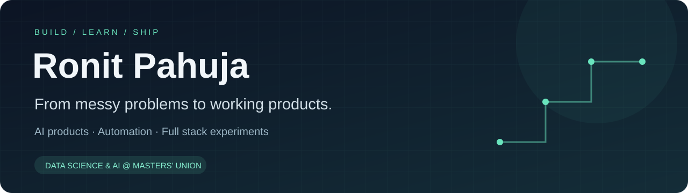

  

  
  
  

## Hey, I'm Ronit 👋

I build AI products and automations around problems people actually run into: keeping up with regulatory changes, navigating insurance paperwork, or finding the right product in a business's inventory.

I'm a **first-year Data Science & AI student** in the Technology & Business Management programme at **Masters’ Union**, and work in **Founder’s Office — Tech & AI at Parallax AI**. I enjoy the whole process: understanding the problem, building a prototype, and explaining it clearly enough for someone to use it.

### Start here

| Project | What it does | Under the hood |
| :--- | :--- | :--- |
| **[Raahat · Team MUVOLT](https://github.com/shinnyminny/MUVOLT)** | A HackIIITD / Esya '26 team project helping caregivers respond to insurance document queries: read requirements, identify missing documents, approve a submission, and track rejections. **Demo uses fictional insurer and hospital sandboxes.** | TypeScript · React · Node.js · Gemini · TinyFish |
| **[PolicyPulse](https://github.com/ronitpahuja08/policypulse)** | Tracks RBI and SEBI notifications, extracts PDFs, and stores structured updates. Includes AI classification and daily brief generation; email distribution requires separate activation. | Python · Gemini · Supabase · GitHub Actions |
| **[Candle](https://github.com/ronitpahuja08/Candle)** | A relationship app with daily questions whose answers unlock only after both partners respond, plus shared plans and a memory wall. | React Native · Expo · FastAPI · MongoDB · WebSockets |
| **[Masters Union Nations](https://github.com/ronitpahuja08/masters-union-nations)** | A conference website with committee information, applications, a delegate ID studio, and a Razorpay checkout integration. | HTML · CSS · JavaScript · Vercel · Razorpay |

**[Explore all my repositories →](https://github.com/ronitpahuja08?tab=repositories)**

### Beyond the public repos

- **Client automation at Parallax AI:** built a WhatsApp workflow that handles initial customer requests and surfaces the closest in-stock match from a client's live inventory.
- **AI Speech Coach:** built a local practice tool with prompts, pause and stumble analysis, response scoring, feedback, and adaptive counter-questions.
- **Personal AI Assistant:** built a local assistant for computer interaction and autonomous multi-step tasks.

The speech coach and personal assistant are local projects; their code is not currently published here.

### What I work with

**Core:** Python · AI product development · workflow automation · data analysis  
**Across my projects:** TypeScript / JavaScript · React / React Native · FastAPI · Node.js · Supabase · MongoDB · GitHub Actions  
**Product side:** prototyping · client requirements · research · project management · public speaking

### A little more about me

- Completed the **Machine Learning Specialization** from **DeepLearning.AI & Stanford Online**: supervised learning, advanced learning algorithms, unsupervised learning, recommenders, and reinforcement learning.
- Led a **20-person MUN team**, helped grow participation from roughly **250 to 300+ delegates**, and brought in **10+ schools** across Delhi NCR.
- Created an event reel that crossed **700K views** and funded MUN participation for about **10 government-school students** through event revenue.
- Outside building: photography, cricket, boxing, and design.

### Let's build something useful

I'm interested in hackathon teams working on **AI agents, practical automation, fintech, and tools that make complicated workflows easier**. I bring hands-on prototyping, product thinking, and the ability to present what we build.

**[Connect with me on LinkedIn →](https://www.linkedin.com/in/ronit-pahuja-a13507378/)**
